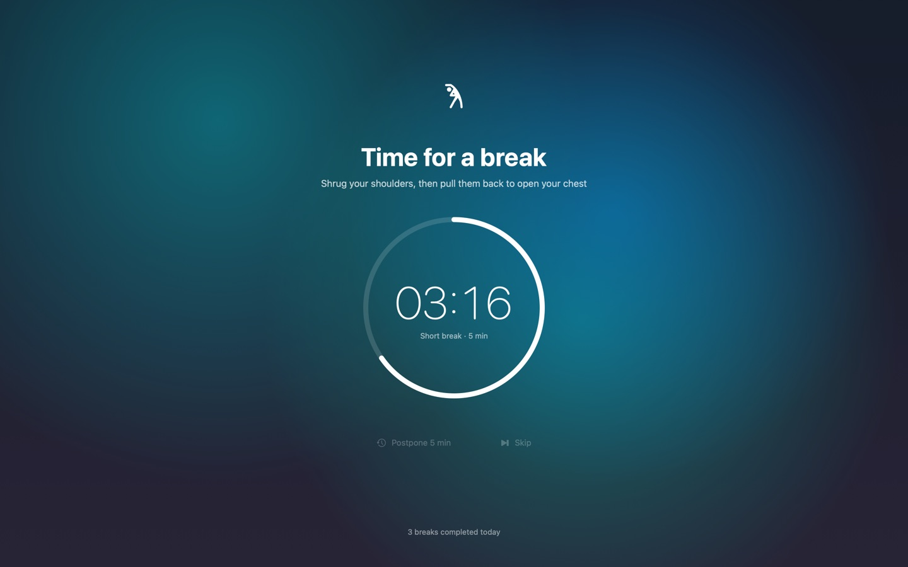
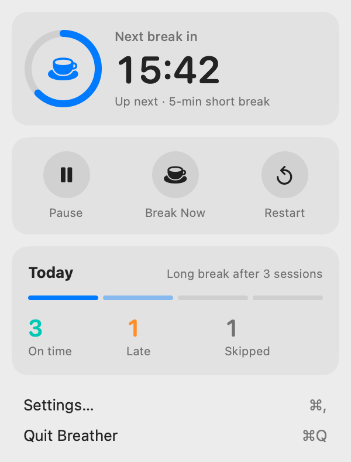
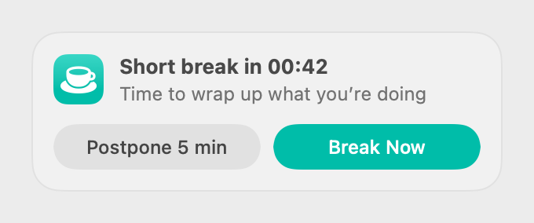
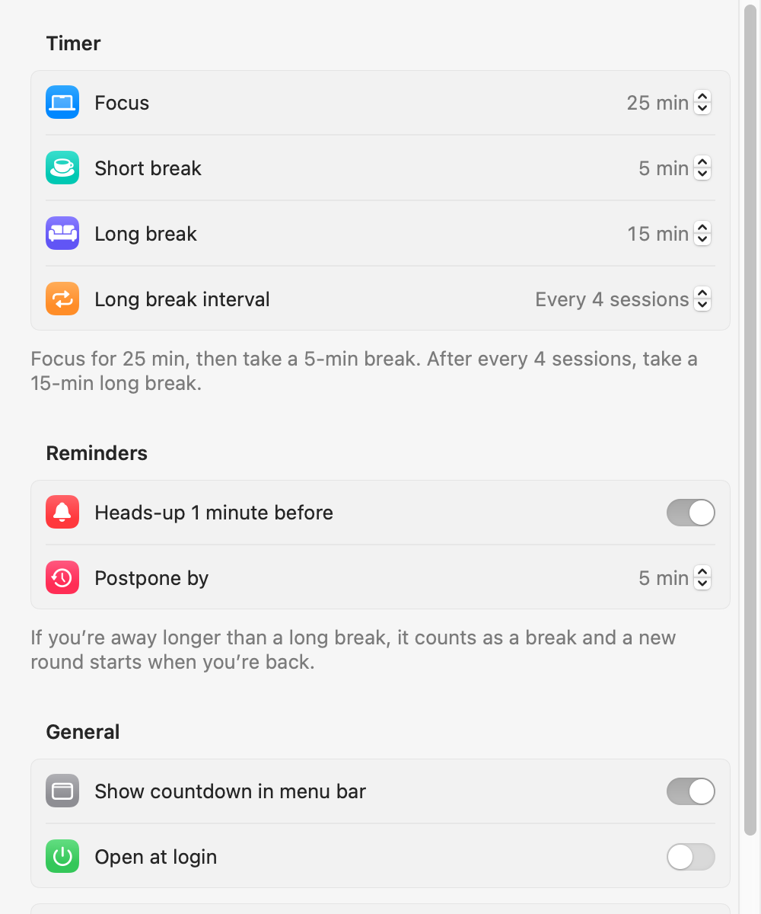
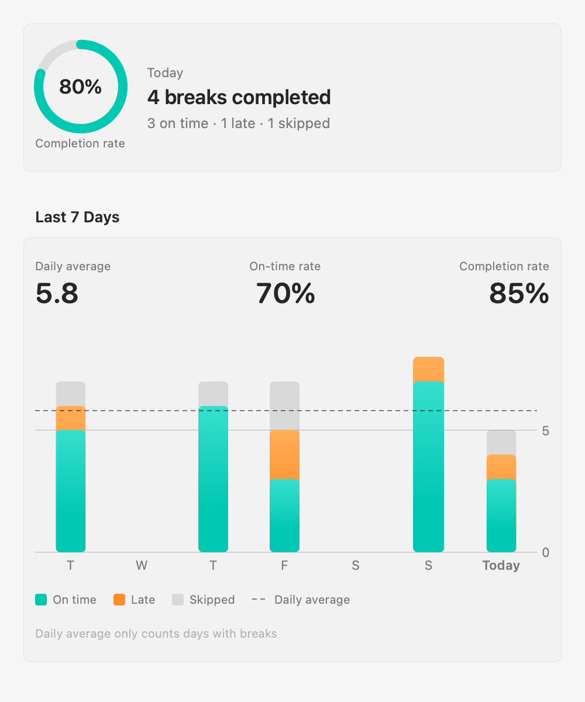

# Breather

English | [简体中文](README.zh-CN.md)

A macOS menu bar app that reminds you to take breaks. After a stretch of focused work, a full-screen overlay gently pulls you away from the screen for a while.

Available in English and Simplified Chinese, following your system language.

<p align="center">
  
</p>

<p align="center">
  
  &nbsp;
  
</p>

> Screenshots are rendered offscreen, so they don't show the real blur and Liquid Glass effects; button backgrounds look lighter than they do on screen.

## Features

- **Focus / break cycle**: 25 minutes of focus and a 5-minute short break by default, with a 15-minute long break every 4 sessions. All durations are adjustable.
- **One-minute heads-up**: a small panel in the top-right corner lets you postpone or start the break right away. It never steals focus, so whatever you're typing keeps going where it was.
- **Full-screen break overlay**: covers every display, including full-screen apps, and suggests a quick way to rest your eyes or stretch. You can postpone or skip.
- **Knows when you're away**:
  - Away from the computer for at least one long break? That counts as rest, and a fresh cycle starts when you're back.
  - If a break ends while you're away, the overlay stays up so your screen isn't left exposed. It goes away, and the next focus session starts, once you move the mouse or press a key.
  - While focusing, watching a video or being in a meeting (anything that keeps the display awake) doesn't count as being away.
  - Sleep and closing the lid are handled the same way.
- **Menu bar countdown**: pause, start a break now, restart the timer, and see how many of today's breaks you took on time, took late (after postponing), or skipped.
- **Statistics**: on-time and completion rates for the last 7 days; the daily average only counts days you actually used your Mac.
- **Open at login**

<p align="center">
  
  &nbsp;
  
</p>

## Installation

Requires macOS 14 or later. Runs on both Apple silicon and Intel Macs.

### Download

1. Download the latest `Breather-<version>.zip` from [Releases](https://github.com/qiangzi4733/Breather/releases), unzip it, and drag `Breather.app` into your Applications folder.
2. The app isn't notarized by Apple, so macOS blocks it the first time you open it. To allow it, either:
   - open **System Settings › Privacy & Security**, scroll down, and click **Open Anyway** next to Breather, or
   - run this in Terminal:

     ```bash
     xattr -dr com.apple.quarantine /Applications/Breather.app
     ```
3. Breather lives in the menu bar and doesn't appear in the Dock. To start it automatically, turn on **登录时打开** (Open at login) in its settings.

### Build from source

Building requires Xcode 26 or later (the app uses the macOS 26 Liquid Glass APIs and falls back to translucent materials on older systems).

```bash
git clone https://github.com/qiangzi4733/Breather.git
cd Breather
make install    # build, install into /Applications, and launch
```

Run `make install` again after pulling new changes. Apps you build yourself aren't blocked by Gatekeeper.

## Privacy

- No network access, no data collection.
- Settings and statistics are stored only on your Mac, in `UserDefaults` (domain `app.breather.Breather`).
- Away detection only reads how many seconds have passed since your last keyboard or mouse input. It never records what you type and doesn't need Accessibility permission.

## Development

```bash
make test                     # unit tests (Swift Testing)
make run                      # build build/Breather.app and relaunch it
make install                  # install into /Applications and launch
make release                  # package a universal dist/Breather-<version>.zip for release
make icon                     # regenerate Resources/AppIcon.icns
build/Breather.app/Contents/MacOS/Breather --snapshot <dir>   # render every screen to PNG offscreen (light + dark)
build/Breather.app/Contents/MacOS/Breather --snapshot <dir> -AppleLanguages '(en)'   # same, in a given language
```

The project is a Swift package with no `.xcodeproj`. To work in Xcode, run `open Package.swift`.

- `Sources/BreatherCore`: pure logic with no AppKit dependency. The timer state machine `BreakScheduler` doesn't own a clock and is advanced from outside every second; sleep, away, and heads-up decisions all live here so they're easy to test.
- `Sources/Breather`: the app itself — menu bar panel, heads-up panel, full-screen overlay, settings window.
- `Resources/Localizable.xcstrings`: String Catalog with Simplified Chinese as the source language and English translations.
- `scripts/build-app.sh`: packages the SwiftPM executable into a signed `.app`, compiling the String Catalog into `.lproj` resources.
- `scripts/release.sh`: packages the release zip; with `DEVELOPER_ID` and `NOTARY_PROFILE` set, it signs with a Developer ID certificate and notarizes.
- `Tests/BreatherCoreTests`: unit tests for the state machine and statistics.

Implementation notes and known pitfalls (in Chinese) are in [CLAUDE.md](CLAUDE.md).

## License

[MIT](LICENSE)
