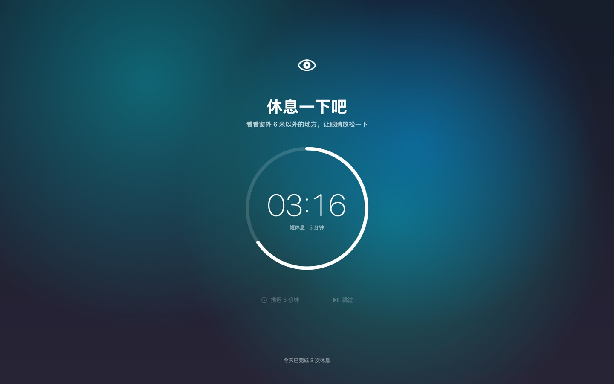
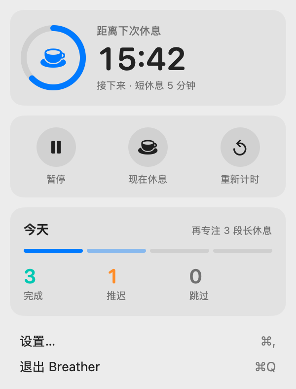
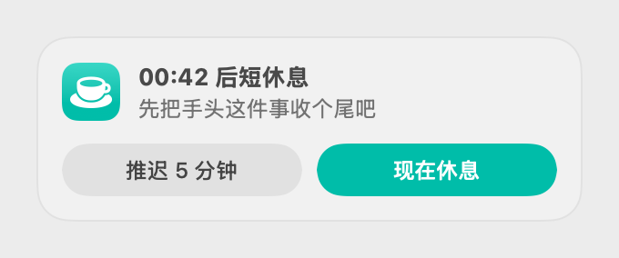
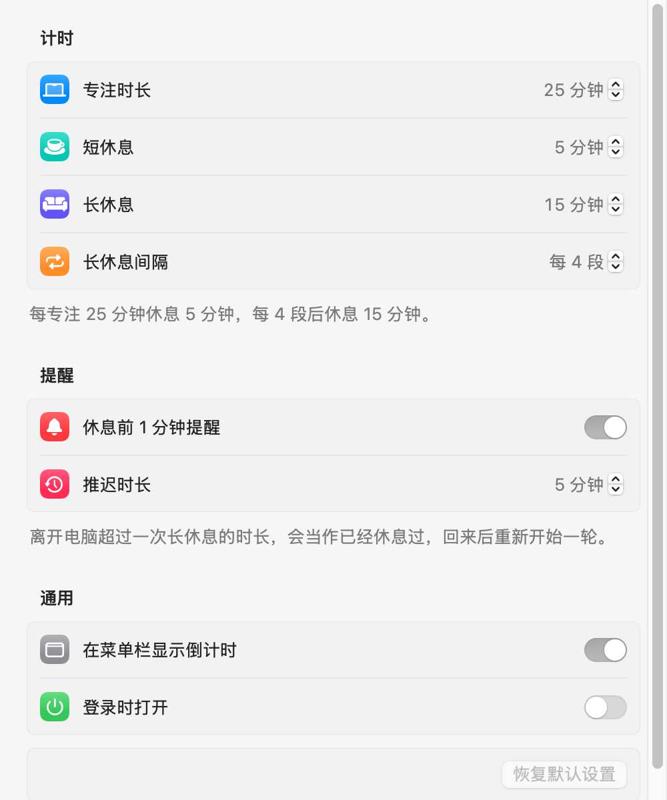
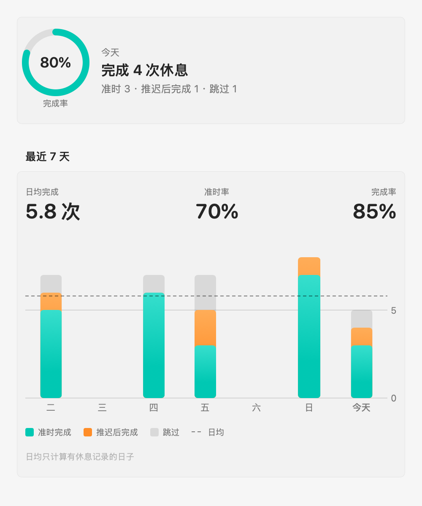

# Breather

[English](README.md) | 简体中文

一个常驻 macOS 菜单栏、提醒你休息的小工具。专注一段时间后，用全屏遮罩把你从屏幕前「请」走一会儿。

界面支持简体中文和英文，跟随系统语言。

<p align="center">
  
</p>

<p align="center">
  
  &nbsp;
  
</p>

> 截图由离屏渲染生成，画不出真实的毛玻璃和 Liquid Glass 效果，按钮底色在截图里会偏淡。

## 功能

- **专注 / 休息循环**：默认专注 25 分钟、短休息 5 分钟，每 4 段来一次 15 分钟长休息，时长都可调
- **休息前 1 分钟预告**：右上角弹出小浮窗，可以先推迟或直接开始休息；浮窗不抢焦点，正在打的字不会被打断
- **全屏休息遮罩**：覆盖所有显示器，也能盖在全屏应用上，附带放松眼睛、伸展身体的小建议；可「推迟」或「跳过」
- **知道你不在**：
  - 离开电脑超过一次长休息的时长，当作已经休息过，回来后重新开始一轮
  - 休息结束时人不在，等你回来再开始计时
  - 播放视频、开会等阻止显示器休眠时，不会误判成离开
  - 睡眠、合盖同理
- **菜单栏倒计时**：面板里可暂停、立即休息、重新计时，查看今天完成 / 推迟 / 跳过的次数
- **统计**：最近 7 天的完成情况和完成率
- **登录时打开**

<p align="center">
  
  &nbsp;
  
</p>

## 安装

要求 macOS 14 或更高版本，支持 Apple 芯片和 Intel。

### 下载安装

1. 在 [Releases](https://github.com/qiangzi4733/Breather/releases) 下载最新的 `Breather-<版本>.zip`，解压后把 `Breather.app` 拖进「应用程序」文件夹
2. 应用没有经过 Apple 公证，第一次打开会被拦下，提示「无法验证开发者」。放行方法任选其一：
   - 打开「系统设置 › 隐私与安全性」，在页面下方找到 Breather，点「仍要打开」
   - 或在终端运行：

     ```bash
     xattr -dr com.apple.quarantine /Applications/Breather.app
     ```
3. Breather 只出现在菜单栏，不会出现在程序坞。想开机自动运行，在它的设置里打开「登录时打开」

### 从源码构建

构建需要 Xcode 26 或更高版本（用到了 macOS 26 的 Liquid Glass API，在旧系统上运行时会自动退回半透明材质）。

```bash
git clone https://github.com/qiangzi4733/Breather.git
cd Breather
make install    # 构建并安装到「应用程序」文件夹，然后启动
```

以后更新代码后再运行一次 `make install` 即可。自己构建的版本不会被 Gatekeeper 拦截。

## 隐私

- 不联网，不收集任何数据
- 设置和统计只保存在本机的 `UserDefaults`（域名 `app.breather.Breather`）
- 空闲检测只读取「距上次键鼠操作过了多少秒」，不记录任何按键内容，也不需要辅助功能权限

## 开发

```bash
make test                     # 单元测试（Swift Testing）
make run                      # 打包 build/Breather.app 并重启运行
make install                  # 安装到 /Applications 并启动
make release                  # 打包双架构的 dist/Breather-<版本>.zip，用于发布
make icon                     # 重新生成 Resources/AppIcon.icns
build/Breather.app/Contents/MacOS/Breather --snapshot <目录>   # 离屏渲染各界面 PNG（浅色 + 深色）
build/Breather.app/Contents/MacOS/Breather --snapshot <目录> -AppleLanguages '(en)'   # 指定界面语言渲染
```

项目用 Swift Package Manager 组织，没有 `.xcodeproj`。需要用 Xcode 时执行 `open Package.swift`。

- `Sources/BreatherCore`：纯逻辑，不依赖 AppKit。计时状态机 `BreakScheduler` 不持有时钟，由外部每秒推进，睡眠、空闲、预告的判断都在这里，便于测试
- `Sources/Breather`：应用本体，包括菜单栏面板、预告浮窗、全屏遮罩、设置窗口
- `Resources/Localizable.xcstrings`：界面文案的 String Catalog，中文为源语言，附英文翻译
- `scripts/build-app.sh`：把 SwiftPM 编译出的可执行文件打包成带签名的 `.app`，并把 String Catalog 编译成 `.lproj` 资源
- `scripts/release.sh`：打包发布用的 zip；设置 `DEVELOPER_ID` 和 `NOTARY_PROFILE` 环境变量后会用开发者证书签名并公证
- `Tests/BreatherCoreTests`：状态机和统计的单元测试

更详细的实现约定和踩过的坑见 [CLAUDE.md](CLAUDE.md)。

## 许可证

[MIT](LICENSE)
